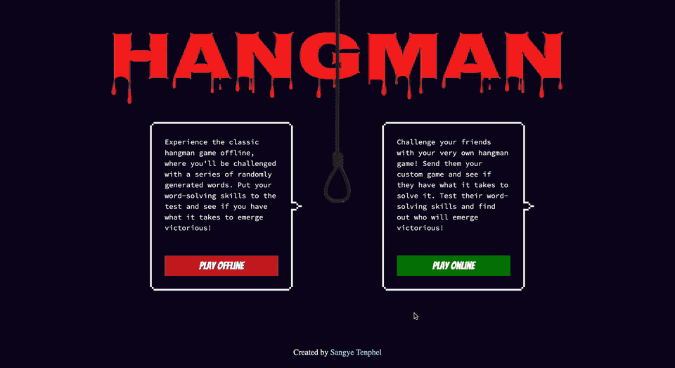

# Hangman With Friends

The classic hangman game with a twist: besides playing against a random word, you can write your own word, get a link, and send it to a friend to solve. Built with a React + TypeScript frontend and a Django REST Framework backend.



▶️ **[Watch the full demo video](https://sangye-tenphel.s3.amazonaws.com/HangmanWithFriends.mp4)** (52 seconds)

## Features

- **Play offline:** guess a random word from a built-in list of about 850 words.
- **Play online with friends:** type a word, click **Generate Word** and copy the share link. Whoever opens the link plays your word.
- **On-screen and physical keyboard:** click the letters or type them. Correct letters turn blue and wrong ones are greyed out.
- **The hangman drawing:** one body part is added for each wrong guess. Six wrong guesses lose the game, and the word is revealed in red.
- **Win and lose messages,** and **Enter** starts a new random word.

## How it works

```
React app (Vite)                         Django backend
────────────────                         ──────────────
Play online → POST /api/  {word}   ───▶  saves the Word, returns its id
share link:  /hangman/<id>
Friend opens the link
             → GET /hangman/<id>   ───▶  returns {word} for that id
```

- **Frontend (`frontend/`):** React 18 with TypeScript and React Router, built with Vite. `pages/` holds the home, online and game screens; `components/` holds the drawing, the word display, the keyboard and the share form. Requests go through Axios.
- **Backend (`backend/`):** Django 5 with Django REST Framework. The `api` app stores words (`Word` model). Its `/api/` endpoint only accepts new words, which are validated as letters only and saved in lowercase. It can't be used to list, edit or delete them, so nobody can see other players' answers. The `hangman` app returns a single word by id at `/hangman/<id>`. Words are stored in PostgreSQL.

## Running it locally

You need Python 3.11+, Node.js 18+ and a PostgreSQL database.

### 1. Backend

```bash
cd backend
python3 -m venv venv
source venv/bin/activate
pip install -r requirements.txt
```

Create `backend/.env` with your database settings:

```
DB_NAME=hangman
DB_USER=your_db_user
DB_PWD=your_db_password
DB_HOST=localhost
DB_PORT=5432
DJANGO_DEBUG=True
```

`DJANGO_DEBUG=True` is for local development only. Anywhere public, leave it off and set:

| Variable | Purpose |
|---|---|
| `DJANGO_SECRET_KEY` | A long random string, generated with `python -c "from django.core.management.utils import get_random_secret_key; print(get_random_secret_key())"` |
| `DJANGO_ALLOWED_HOSTS` | The backend's domain(s), comma-separated (default `localhost,127.0.0.1`) |
| `CORS_ALLOWED_ORIGINS` | The frontend's address(es), comma-separated (default `http://localhost:5173`) |

Then create the tables and start the server:

```bash
python manage.py migrate
python manage.py runserver
```

The API runs at http://localhost:8000.

### 2. Frontend

```bash
cd frontend
npm install
```

By default the app talks to the backend at `http://localhost:8000`. If yours runs elsewhere, create `frontend/.env` with:

```
VITE_API_URL=https://your-backend.example.com
```

Then start it:

```bash
npm run dev
```

Open http://localhost:5173. Offline mode works without the backend; online mode needs both running.

### Running the tests

```bash
cd backend
python manage.py test
```

The tests cover creating words (including rejecting empty, non-letter and over-long words, and storing words in lowercase), the shared-game endpoint, and checking that words can't be listed, edited or deleted through the API.

## Built with

- **Frontend:** React 18, TypeScript, Vite, React Router, Axios
- **Backend:** Python, Django 5, Django REST Framework, django-cors-headers
- **Database:** PostgreSQL

The app was originally deployed on WSO2 Choreo; that deployment is no longer running.

Created by [Sangye Tenphel](https://sangyetengkhar.com/), 2024.
